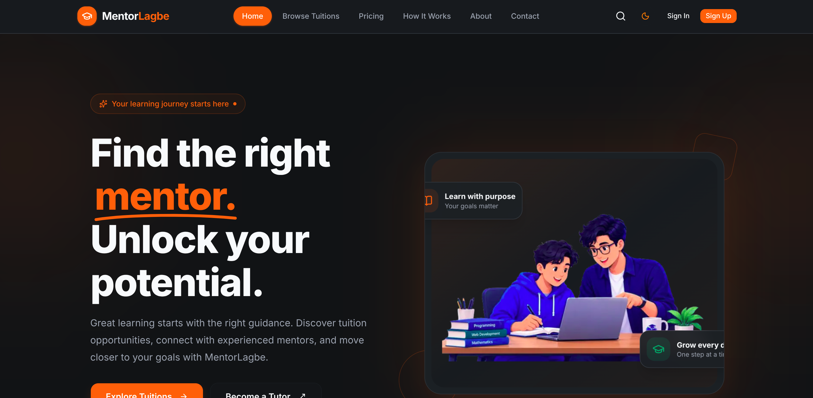

# MentorLagbe — Backend API

<p align="center">
  
</p>

<p align="center">
  RESTful backend API for the MentorLagbe Smart Tuition & Mentorship Platform.
</p>

<p align="center">
  <a href="https://mentor-lagbe-web.vercel.app/">Live Frontend</a> •
  <a href="https://mentor-lagbe-web-server.vercel.app/">Live Backend API</a>
</p>

---

## Overview

The MentorLagbe backend powers a full-stack tuition and mentorship marketplace connecting students, tutors, and administrators.

It provides authentication integration, role-based authorization, tuition management, application processing, subscription payments, and other essential platform services.

Built with **Node.js, Express.js, TypeScript, MongoDB, Better Auth, and Stripe**, the backend is designed to support secure API communication and dynamic application workflows.

## Core Features

### Authentication & Security

- Better Auth integration.
- JWT-based API authentication.
- Role-based authorization.
- Student, Tutor, and Admin access control.
- Protected API endpoints.
- Secure session verification.

### User Management

- User profile management.
- Role-based user access.
- Student and tutor account management.
- Subscription plan information.

### Tuition Management

- Create tuition posts.
- Retrieve and browse tuition listings.
- Update and delete tuition posts.
- Activate and close tuition listings.
- Tuition approval and moderation.
- Search and filtering support.

### Application Management

- Submit tuition applications.
- Retrieve application information.
- Manage application statuses.
- Tutor and student application workflows.

### Bookmark Management

- Add and remove saved tuitions.
- Retrieve user-specific saved tuition posts.
- Free plan bookmark restrictions.
- Unlimited bookmarks for Pro students.

### Payment Integration

- Stripe checkout integration.
- Student and Tutor Pro subscription payments.
- Payment record management.
- Subscription status updates.
- Payment verification and webhook integration.

### Image Upload

- ImgBB integration for image hosting.
- Support for profile and tuition-related images.

## Technology Stack

| Category       | Technologies |
| -------------- | ------------ |
| Runtime        | Node.js      |
| Framework      | Express.js   |
| Language       | TypeScript   |
| Database       | MongoDB      |
| Authentication | Better Auth  |
| Authorization  | JWT          |
| Payments       | Stripe       |
| Image Hosting  | ImgBB        |
| Validation     | Zod          |
| Deployment     | Vercel       |

## Live Links

- **Frontend:** https://mentor-lagbe-web.vercel.app/
- **Backend:** https://mentor-lagbe-web-server.vercel.app/

## Getting Started

### Prerequisites

- Node.js 20 or later
- npm
- MongoDB Atlas account or local MongoDB instance
- Stripe account for payment integration
- ImgBB API key

### Installation

Clone the repository:

```bash
git clone YOUR_BACKEND_REPOSITORY_URL
cd mentor-lagbe-server
```

Install dependencies:

```bash
npm install
```

### Environment Variables

Create a `.env` file in the backend root directory.

Configure the variables required by your existing backend:

```env
NODE_ENV=development
PORT=5000

MONGODB_URI=your_mongodb_connection_string
DB_NAME=mentor-lagbe

BETTER_AUTH_SECRET=your_better_auth_secret

CORS_ORIGIN=http://localhost:3000
```

Also configure the existing Stripe and ImgBB credentials required by the application.

**Important:** Never commit `.env` files, API keys, database credentials, or secret values to GitHub.

### Run Development Server

```bash
npm run dev
```

The backend will run at:

```text
http://localhost:5000
```

### Build

```bash
npm run build
```

### Run Production Server

Use the production start command configured in `package.json`.

## API Overview

The backend provides API endpoints for the following resources:

| Resource              | Purpose                               |
| --------------------- | ------------------------------------- |
| `/api/auth/*`         | Authentication and session management |
| `/api/users/*`        | User management                       |
| `/api/tuitions/*`     | Tuition listing and management        |
| `/api/applications/*` | Tuition applications                  |
| `/api/payments/*`     | Payment and subscription management   |
| `/api/stats/*`        | Dashboard statistics                  |
| `/api/health`         | Server health check                   |

Exact endpoints and supported HTTP methods are defined in the backend source code.

## Database Design

The application uses MongoDB with four primary application collections:

| Collection     | Responsibility                                     |
| -------------- | -------------------------------------------------- |
| `users`        | User profiles, roles, and subscription information |
| `tuitions`     | Tutor-created tuition listings                     |
| `applications` | Student applications                               |
| `payments`     | Payment and transaction records                    |

Better Auth may also maintain its own authentication-related collections.

## Subscription Plans

| Plan | Student             | Tutor                   |
| ---- | ------------------- | ----------------------- |
| Free | Maximum 5 bookmarks | Maximum 2 tuition posts |
| Pro  | Unlimited bookmarks | Unlimited tuition posts |

Subscription payments are processed through Stripe.

## Deployment

The backend is deployed on Vercel.

Production deployment requires correctly configured:

- MongoDB connection string and database access.
- Better Auth secret and trusted origins.
- Frontend CORS origin.
- Stripe credentials and webhook configuration.
- ImgBB API key.

## Author

**Md. Shahidul Islam**

Full Stack Developer

- Portfolio: https://md-shahidul-portfolio.vercel.app/
- GitHub: https://github.com/shahidul91325
- LinkedIn: https://www.linkedin.com/in/shahidul91325

---

<p align="center">
  MentorLagbe Backend — Powering a smarter tuition marketplace.
</p>
